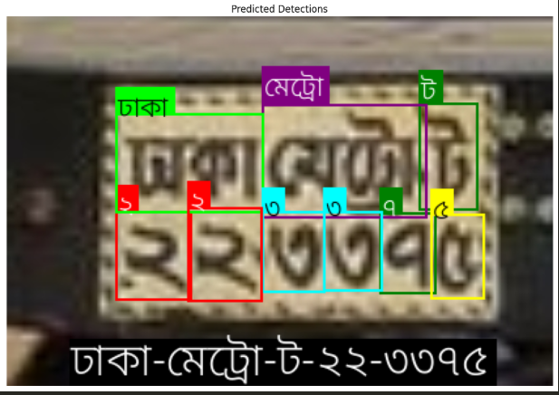
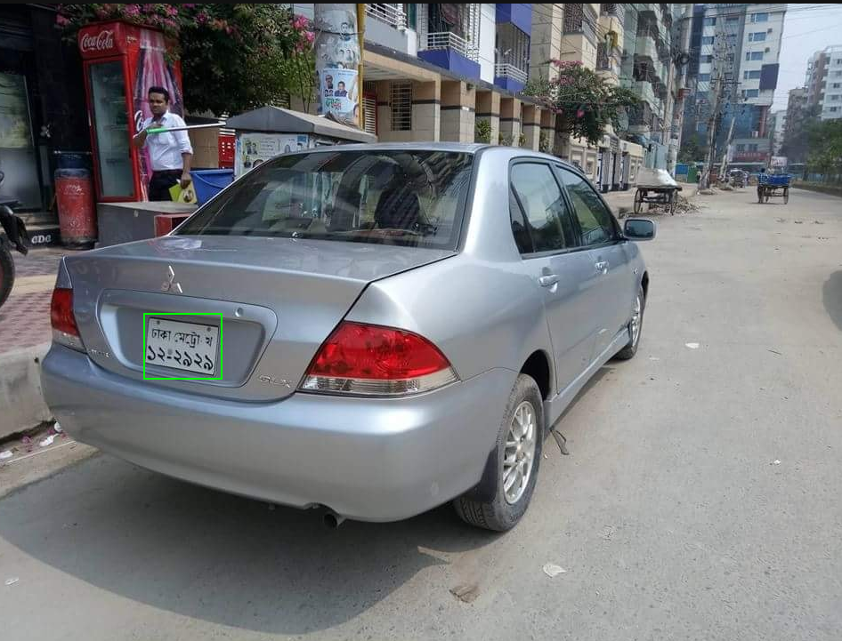

# Bangla LPDB - A (YOLO Ready)

This dataset is a reformatted and enhanced version of the **Bangla LPDB - A** dataset, originally published by Ataher Sams and Homaira Huda Shomee. It has been meticulously prepared to be **plug-and-play** for YOLO (You Only Look Once) object detection models, making it incredibly easy for researchers and developers to use for license plate detection tasks in Bangladeshi vehicles.

---

## Original Dataset Acknowledgment

This dataset is built upon 

Ataher Sams, & Homaira Huda Shomee. (2021). Bangla LPDB - A (Version v1) [Data set]. International Conference on Digital Image Computing: Techniques and Applications (IEEE DICTA), Gold Coast, Queensland Australia. Zenodo. https://doi.org/10.5281/zenodo.4718238

We extend our sincerest gratitude to them for creating such a comprehensive and vital resource for the research community.

---

## Key Enhancements

While the original Bangla LPDB - A dataset is an excellent collection, this version provides significant improvements for immediate use with YOLO models:

* **YOLO Dataset Structure:** The dataset has been meticulously restructured to follow the standard YOLO format, including all necessary annotation files.
* **`dataset.yaml` Included:** A `dataset.yaml` file is provided for seamless integration with popular deep learning frameworks like Ultralytics YOLO.
* **Class Names:** Separate files for both **Bengali** and **English** class names are included, offering flexibility for various applications.
* **Pre-split Data:** The dataset is pre-split into optimal ratios for training, validation, and testing:
  * **Training Set:** 70%
  * **Validation Set:** 20%
  * **Testing Set:** 10%
  * 

---

## Preview

License Plate to Text



Vehicle to License Plat



---

## The Original Paper

H. H. Shomee and A. Sams, "License Plate Detection and Recognition System for All Types of Bangladeshi Vehicles Using Multi-step Deep Learning Model," 2021 Digital Image Computing: Techniques and Applications (DICTA), Gold Coast, Australia, 2021, pp. 01-07,  https://doi.org/10.1109/DICTA52665.2021.9647284.

---

## Dataset Citation

**Users of this dataset are required to cite the original research paper**, which introduces the Bangla LPDB - A dataset and its applications. Please use the following citation:

```bibtex
@INPROCEEDINGS{9647284,
  author={Shomee, H. H. and Sams, A.},
  booktitle={2021 Digital Image Computing: Techniques and Applications (DICTA)},
  title={License Plate Detection and Recognition System for All Types of Bangladeshi Vehicles Using Multi-step Deep Learning Model},
  year={2021},
  pages={01-07},
  doi={10.1109/DICTA52665.2021.9647284}
}
```

---

> Modified by
> 
> **Ashikur Rahman Shad**
> 
> [ashikur-rahman-shad (Ashikur Rahman Shad) · GitHub](https://github.com/ashikur-rahman-shad/)
> 
> 
